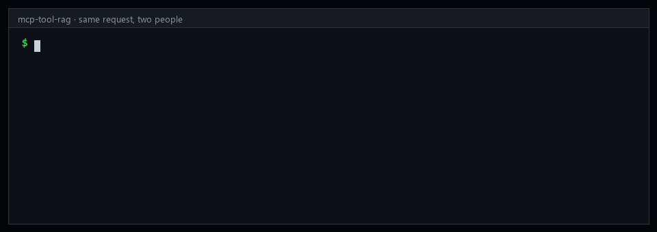

# mcp-tool-rag

**RAG for AI tools: give each agent only the tools it needs, and only the ones its user is
allowed to use.**



## Why the analysis matters as much as the code

Everyone is building RAG right now, and most of it is judged on a handful of questions its
builder tried by hand. So before deciding how this should search, we measured it, three ways:
a synthetic company with permissions, **1,351 real user requests**
([BFCL](https://proceedings.mlr.press/v267/patil25a.html)), and the public
[ToolRet](https://arxiv.org/abs/2503.01763) benchmark (**44,453 tools**).

The finding we'd most want other RAG builders to see:

> **When the same AI writes your test questions and your improvements, the gain you measure
> can be inflated about 10×.** Giving each tool AI-written example requests looked like a
> **+32 point** jump on our AI-written test set. On real people's requests the same change was
> worth **+3**. Still real, but a tenth of what the synthetic test claimed.

Also measured: which search method to use depends on your data, but mixing keyword and meaning
search is the safe default; ordinary tool search shows people tools they can't use on 63–88%
of requests; and permissions have to be applied *before* ranking, not after. Full results are
[below](#results).

## What you can do with this today

1. **Read the findings.** The [results](#results), with every number reproducible from `eval/`.
2. **Test tool search on *your* tools.** Export your MCP servers' tool lists with one command,
   add some real requests, and see which method works for you: see
   [data/real/README.md](data/real/README.md).
3. **Use it as a Python library.** Give it your tools and each user's allowed list (mcp-gatekeeper's
   format, or your own check) and get back the right few tools. See [Run it](#run-it).
4. **Coming next:** a standalone MCP server. Point it at your existing MCP servers and every
   agent gets a `search_tools` tool, with optional per-user permissions.

## The problem it solves

As teams connect more MCP servers, an agent ends up with dozens or hundreds of tools. Handing
it all of them on every request causes three problems:

1. **Cost and latency.** Every tool definition is sent with every request.
2. **Wrong picks.** Tool selection gets worse as the list grows; Anthropic's own guidance puts
   the drop-off around 30–50 tools.
3. **Exposure.** People see, and agents plan around, tools they're not allowed to use. Even
   if the call is refused later, the tool's name and description have already leaked.

It fixes all three: **filter by the caller's permissions first, then retrieve the few relevant
tools.** The agent only ever sees those. It's retrieval-augmented generation where the thing
retrieved is tools, not documents.


```bash
python examples/demo.py "this customer got charged twice, give them their money back"
```

> **Status: research preview.** The retrieval and evaluation are complete; the MCP integration
> (a `search_tools` tool inside [mcp-gatekeeper](https://github.com/rafae-gill/mcp-gatekeeper),
> and per-key filtering of `tools/list`) is in progress.
>
> **Known limitation:** if the caller has *no* relevant tool, it still returns the k closest
> ones. Asked to roll back a deploy, a finance key (which has no deploy tools) gets
> `refund_payment`, `get_spend` and `updatePage`. A "nothing relevant" cut-off is next.

## Works with mcp-gatekeeper

The permissions themselves live in [mcp-gatekeeper](https://github.com/rafae-gill/mcp-gatekeeper):
each person's key carries a policy (which tools, which data, which hours, how often). This repo
has no permission system of its own. Step 1 reads those same policies, through
mcp-gatekeeper's own policy code (`allowed_for` → `mcp_gatekeeper.ServerPolicy`), so the two
can't disagree about what a key allows.

They use the permissions for different jobs:

| | mcp-gatekeeper | mcp-tool-rag |
|---|---|---|
| Stores each person's permissions | ✅ source of truth | reads them |
| Decides which tools the agent **sees** | | ✅ only relevant, allowed ones |
| Blocks a forbidden **call** at run time | ✅ refuses and logs it | |

Together they're two layers of defence: tool-rag keeps forbidden tools out of the agent's
sight, and mcp-gatekeeper refuses the call if one is attempted anyway.

Either works alone. mcp-gatekeeper doesn't need this repo, and this repo accepts any permission
set in mcp-gatekeeper's shape (`{"warehouse": {"tools": [...]}}`). Running tool-rag *inside*
the gate, as a `search_tools` tool, is the integration in progress.

## Results


Three evaluations, from hardest-to-trust to most credible. All methods share one pipeline, so
the comparisons within each table are like for like.

### Real user requests: BFCL "live"

1,351 user-contributed requests from the
[Berkeley Function Calling Leaderboard](https://proceedings.mlr.press/v267/patil25a.html),
each searching **one pooled catalog of 528 functions** (instead of BFCL's usual 1–4 candidates).

| | Keyword | Meaning | Mix | **Mix + examples** |
|---|---|---|---|---|
| Right tool ranked 1st | 55% | 63% | 63% | **66%** |
| Right tool in top 5 | 80% | 89% | 89% | **92%** |
| Right tool in top 10 | 87% | 93% | 93% | **96%** |

Examples were written from the tool catalog only, without seeing the requests; 39 that came
out suspiciously close to a test request were removed before scoring.

### Public benchmark: ToolRet

[ToolRet](https://arxiv.org/abs/2503.01763) (ACL 2025): 7,961 requests over a **44,453-tool**
corpus, scored with the benchmark's own protocol (NDCG@10, and C@10 = all needed tools in the
top 10, averaged over its web / code / customized categories).

| Setting | Keyword | Meaning | **Mix** |
|---|---|---|---|
| Request only: NDCG@10 / C@10 | 27.9 / 26.2 | 25.1 / 24.6 | **29.7 / 29.4** |
| With task instruction: NDCG@10 / C@10 | 40.2 / 40.4 | 37.9 / 39.1 | **42.7 / 43.4** |

The mix wins in every setting and every category. (Example requests weren't generated for
44k tools.) These numbers come from this repo's pipeline; small implementation differences
mean they shouldn't be read as a head-to-head with the paper's tables.

### Permissions: a synthetic company

A realistic catalog of 158 tools on 8 servers (warehouse, ads, CRM, docs, GitHub, Slack,
billing, deploy), 6 roles, and 200 requests, 27 of them asking for a tool the caller may not
use. Built to be hard: requests never reuse the tools' own wording.

| | Keyword | Meaning | Mix + examples |
|---|---|---|---|
| A permission-unaware top 5 shows a **forbidden** tool | 88% | 76% | 63% |
| …and it's the exact forbidden tool the request wanted | 48% | 67% | 96% |
| **The router** shows a forbidden tool | **0%** | **0%** | **0%** |
| Filtering *after* search instead of before: right tool in top 5 | 35% (vs 41%) | 51% (vs 60%) | 86% (vs 92%) |

Better search makes leaks *worse*: the more relevant the results, the more often a
permission-unaware search surfaces exactly the tool the caller isn't allowed. Permissions have
to come first. The router asserts it on every request in the evaluation.

## What we learned

1. **The best single method depends on the data.** Meaning-based search beat keyword search on
   real requests (89% vs 80%) and lost to it on ToolRet's long technical API docs. Fusing the two
   by rank was best on ToolRet, tied on real requests, and best everywhere once example requests
   were added. The one place it lost was the synthetic set without examples (51% vs 60%), where
   keyword search alone was so weak it dragged the mix down.
2. **Example requests per tool help on real wording, modestly:** +3–5 points at every cut-off on
   BFCL. Matching each example separately beats appending them to the description (89% vs 75%
   on the synthetic set).
3. **AI-written tests inflate AI-written improvements, about 10×.** On the synthetic test, where
   Claude wrote both the requests and the examples, examples added **+32 points**. On real
   requests: **+3**. If your eval and your enrichment come from the same model, measure on
   human-written requests before believing the gain.
4. **Filter before you rank.** Filtering afterwards costs accuracy (top-k slots spent on tools
   that get dropped) and, without it, nearly every request leaks something.

Honesty checks behind these numbers: test-set leakage checks on every example set, an
independent review of all 200 synthetic labels (189 kept, 10 equally-valid alternates added,
1 corrected; scores moved by under a point), and the fast implementation verified to return
identical top-10 results to the reference one on every request.

## Run it

```bash
git clone https://github.com/rafae-gill/mcp-tool-rag && cd mcp-tool-rag
pip install -e ".[dev]"
python -m pytest -q                                   # router behaviour

python eval/run_eval.py                               # synthetic set, all methods
python eval/fetch_external.py                         # public benchmarks, ~23 MB, from source
python eval/convert_bfcl.py && python eval/run_eval.py --data external/bfcl_search \
       --examples external/bfcl_search/examples_strict.json --out results/bfcl
python eval/toolret_eval.py                           # slow on CPU: embeds 44k tools once
```

Embeddings use [bge-small-en-v1.5](https://huggingface.co/BAAI/bge-small-en-v1.5) through
fastembed: about 67 MB, CPU only, no API key, nothing leaves the machine.

```python
from mcp_tool_rag import BM25, Embeddings, Hybrid, ToolRouter, allowed_for, load_catalog

catalog = load_catalog("data/catalog.json")
emb = Embeddings(catalog)
router = ToolRouter(catalog, Hybrid(BM25(catalog), emb))

key_permissions = {"warehouse": {"tools": ["run_query", "describe_table"]}}   # mcp-gatekeeper shape
router.search("how much did we spend on ads last quarter", allowed_for(key_permissions), k=5)
```

## Repo layout

| Path | What |
|---|---|
| `mcp_tool_rag/` | router, retrievers (BM25, embeddings, example-enriched, hybrid) |
| `data/` | synthetic catalog, roles, 200 requests, label review, example requests |
| `eval/` | scoring, failure analysis, leakage check, benchmark download and conversion |
| `results/` | scores for every run reported above |
| `examples/demo.py` | the demo above: one request, two roles, plus an ordinary search |
| `docs/` | GIF, diagram, results chart, social card |

Benchmarks are downloaded from their sources into `external/` and never re-published here.

## Credits

- BFCL: Patil et al., *The Berkeley Function Calling Leaderboard*, ICML 2025.
- ToolRet: Shi et al., *Retrieval Models Aren't Tool-Savvy: Benchmarking Tool Retrieval for Large Language Models*, Findings of ACL 2025.
- bge-small-en-v1.5: BAAI.

## License

MIT © Muhammad Rafae Gill
